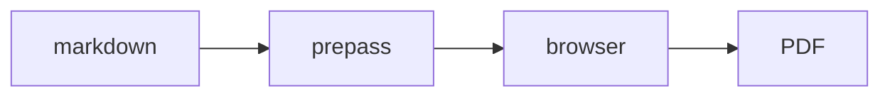

# 如何将图表放入文档中(并导出 PDF 之外的格式)

本指南涵盖随 `/make-pdf` 和 `/diagram`(v1.58.0.0+)提供的图表 + 多格式引擎。此处的一切都完全离线运行:mermaid 和 excalidraw 运行时在 `lib/diagram-render/` 中 vendored,并由 `bin/gstack-render.ts` 加载到浏览器中,该服务从你的机器上为一次渲染提供环回服务。没有 CDN,在渲染时没有网络。浏览器是你的 Aside 浏览器(打开时,macOS 15+);当它不在时 — Linux、Windows,或应用程序关闭 — 同一个包在 gstack 自己的捆绑浏览器中渲染,因此它在每个平台上离线渲染(PNG 在回退时为 1x,通过 Aside 为 2x)。

## 在 PDF 中渲染 mermaid 图表

在 markdown 中放置一个围栏。就这样。

````markdown

````

```bash
make-pdf generate doc.md out.pdf
```

围栏渲染为**矢量**图表(在任何缩放下都清晰,可选择的文本),标题作为标题和可访问性标签。原始 mermaid 源保留在 `data-gstack-source` 属性中,以 base64 编码,以供调试和往返(HTML 注释会破坏 mermaid 的 `-->` 箭头)。一个注意点:围栏必须从**第 0 列**开始 — 缩进的围栏(例如在列表中)按设计保持为纯代码块。

**围栏选项**(在信息字符串中以空格分隔):

| 选项 | 效果 |
|---|---|
| `title="..."` | 图表下方的标题 + `aria-label` |
| `render=false` | 将围栏保留为纯代码块 |
| `page=landscape` | 强制此图表到其自己的横向页面 |
| `page=portrait` | 取消此图表的自动横向 |

无法解析的围栏渲染为响亮的红色诊断块,带有解析错误和源摘录 — 你的文档仍然可以构建,并且错误不可能被忽略。

` ```excalidraw ` 围栏以相同的方式工作;正文是完整的 `.excalidraw` 场景文件(excalidraw.com 通过 File → Save 保存的内容)。

## 控制图像大小和方向

本地图像自动内联(相对路径根据 markdown 文件解析)并且**永远不会被截断** — 每个图像上限为内容框。超大照片会按打印分辨率缩小(内容宽度的 300dpi),因此手机照片不会使文档膨胀。

图像安全默认值:远程(http/https)图像**被阻止并带有可见的占位符**,除非你传递 `--allow-network`。解析到 markdown 目录之外的图像路径(即使通过符号链接)仍然内联但会大声警告。超过 64MB 的文件和非常规文件(fifo、设备)会降级为占位符,而不是挂起渲染。

每图像指令紧跟在图像之后:

```markdown
{width=full}
{width=2in}
{page=landscape}
{page=portrait}
```

`width=` 接受 `full`、百分比(`50%`)或尺寸(`3in`、`8cm`、`200px`)。`page=` 强制或取消专用的横向页面。

**自动横向:** 宽度大、文本小、类似图表的图像会自动获得其自己的垂直居中的横向页面 — 在其他纵向文档中。启发式方法故意保守(纵横比 ≥ 1.8,内在宽度超过内容框的约 2.5 倍,以及类似图表的 alt 词:diagram / architecture / flowchart / chart / graph)。如果它没有按你想要的方式触发,请添加 `{page=landscape}`;如果它在你不想触发时触发,请添加 `{page=portrait}`。

## 导出单文件 HTML 或 Word

```bash
make-pdf generate doc.md out.html --to html
make-pdf generate doc.md out.docx --to docx
```

- **`--to html`** 写入一个独立的文件:图表作为内联 SVG,图像作为 data URI,在默认离线姿势下零网络引用(`--allow-network` 故意保持远程图像标签有效),加上屏幕阅读层(居中度量、填充)。通过电子邮件发送它、附加它、在任何地方打开它。
- **`--to docx`** 是内容保真度导出:标题、表格、代码块、列表和图表(作为 300dpi PNG 嵌入,带有 alt 文本)被继承。页面完美的布局不是 — 一旦打开,那是 Word 的工作。

注意:`--to` 是输出格式。`--format` 是 `--page-size` 的旧别名 — 不同的事物。

## 从英语生成图表

```
/diagram make a flowchart of our deploy pipeline: build, test, canary, promote
```

该 skill 编写 mermaid 并发出**三元组**:

| 文件 | 用途 |
|---|---|
| `<slug>.mmd` | 真实来源 — 编辑并重新渲染 |
| `<slug>.excalidraw` | 在 excalidraw.com 打开(File → Open),移动框,交回 |
| `<slug>.svg` / `<slug>.png` | 文档、问题、README、聊天 |

流程图转换为完全可编辑的 excalidraw 场景。其他 mermaid 类型(sequence、state、gantt)渲染为 SVG/PNG,但跳过 `.excalidraw` 工件 — 该 skill 会告诉你的上游转换器限制。

对于文档,将 `.mmd` 源嵌入你的 markdown 而不是 PNG — `/make-pdf` 将其渲染为矢量,并且图表永远保持可编辑。

## CI:大声失败而不是发布占位符

```bash
make-pdf generate docs.md --strict
```

缺少本地图像、阻止的远程图像、目录外的图像读取(解析到 markdown 目录之外的路径或符号链接)、超大文件(>64MB)和非常规文件都退出非零,而不是降级为警告或占位符 — 对于应该破坏构建的损坏图像的文档管道。

## 故障排除

- **"diagram-render bundle not found"** → 在 gstack 仓库中运行 `bun run build:diagram-render`,或重新运行 `./setup`。
- **图表渲染但内联看起来很挤** → 它很宽;在围栏上使用 `page=landscape` 为其提供空间。
- **两行"赛道"循环而不是一条长线:** mermaid 子图技巧 — 顶层 `flowchart TB`,两个子图具有 `direction LR` 和 `direction RL`,连接*子图*(跨子图边界的节点级边会默默地禁用 `direction`)。
- **"[remote image blocked]" 占位符** → 远程图像默认永远不会被获取(离线姿势);该标签被替换为可见的占位符,以便浏览器也无法在打印时获取它。传递 `--allow-network` 以选择加入。
